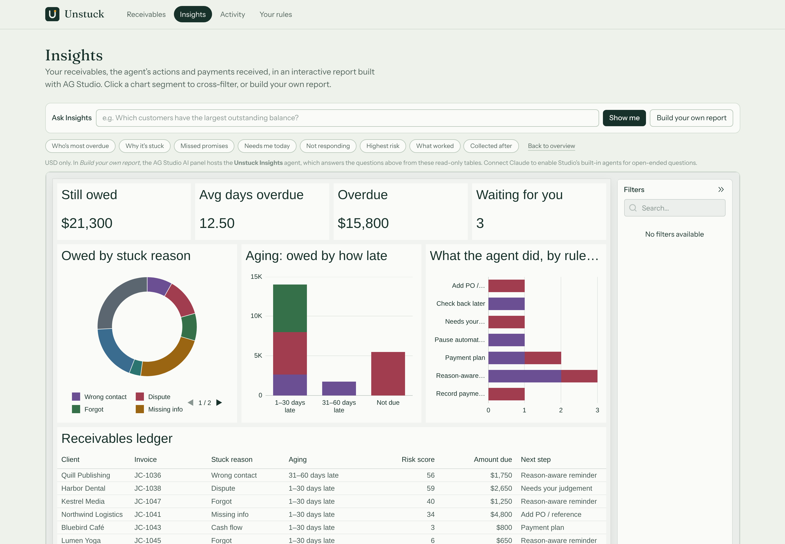

# Unstuck

**Every unpaid invoice has a reason. Unstuck finds it, and resolves it with your client, inside PayPal.**

Unstuck is an AI receivables agent for small businesses that invoice with **PayPal Invoicing**. Most collections tools send the same reminder again and again. Unstuck works out *why* each invoice is stuck: a missing PO, a cash crunch, a dispute, the wrong contact, a cheque in the post, or a client who simply forgot. It fixes that cause with a native PayPal action, within rules the owner sets.

Clients get a private page where they can say what's wrong ("I can do $400 now"). An assistant there can only offer terms the owner has already allowed, and accepting one sets it up in PayPal on the spot.

Built for the [PayPal AI Hackathon 2026](https://paypalaihackathon.devpost.com/). MIT licensed.


## The problem

- **56%** of US small businesses have unpaid invoices outstanding. Those that do are owed **$17,500** on average ([QuickBooks 2025](https://quickbooks.intuit.com/r/small-business-data/small-business-late-payments-report-2025/), n=2,487).
- **29%** of owners have delayed their own pay because clients paid late ([Bluevine, Mar 2026](https://www.bluevine.com/newsroom/late-payment-gap-survey-press-release), n=1,052).
- Yet only 19% charge late fees, and in a UK survey most freelancers said they fear losing the client if they chase.

Invoices don't get stuck for one reason, so another reminder fixes only one of them. Sources and caveats: [`research/PHASE_2_COMPETITIVE_RESEARCH.md`](research/PHASE_2_COMPETITIVE_RESEARCH.md).

## What Unstuck does differently

There are other AI collections tools, including entries in this hackathon (*Owed*, *Invoice Chaser*). They draft better reminders. Unstuck does three things they don't:

1. **Diagnoses the blocker.** It separates what the client *said* (quoted evidence) from what it *infers*, and states the expected outcome, the risks and the alternatives.
2. **Executes the remedy as PayPal state, not as an email:**

| Why it's stuck | What happens in PayPal |
|---|---|
| Missing PO / AP details | Invoice updated with the PO; AP inbox CC'd; PayPal re-sends it (`PUT /v2/invoicing/invoices/{id}`) |
| Cash is tight | Payment plan: partial payments with a minimum due that moves as each installment arrives (`PUT …` `partial_payment`, then webhooks) |
| Slipped their mind | A short reminder in the owner's voice, delivered by PayPal (`POST …/remind`), automatic within the owner's limits |
| Wrong contact | Reminder to the new address, after owner approval |
| Disputing the work | PayPal's automatic reminders paused (`POST …/cancel-reminders`); owner gets the evidence and a suggested reply |
| Cheque in the post | Payment recorded once the owner confirms it arrived (`POST …/payments`) |
| Large first-time invoice | Early-payment discount as a PayPal rule that expires on its own (`POST …/conditional-rules`) |

3. **Resolves it with the client.** Every reminder links to a private page. The client can ask questions or propose a plan; the assistant can only surface plans the deterministic policy engine allows. The client sees the consequences in plain words before accepting.

> **The agent proposes. Your rules decide what's allowed. PayPal executes. You stay in control.**

## How the agent works

**Run the agent** performs one observable pass, and every step is shown live:

```
Sync from PayPal → prioritise by risk → for each invoice:
  gather evidence → diagnose (Claude) → plan → check your rules → act or ask → verify in PayPal
plus follow-ups: installments coming due, missed promises
```

- **Diagnosis:** Claude (`claude-opus-5-5`) with structured outputs, sanitised, and turned into typed actions *by code*. Plan maths, discount caps, PO and email validation, and links are never taken from the model.
- **Policy engine:** a pure function that classifies every action as *auto* / *needs approval* / *blocked*, with itemised checks shown on each card. Money changes proposed by the agent always need the owner.
- **Risk:** a transparent heuristic, not a trained model. Every point comes from a named factor, shown in the drawer.
- **30-day outlook:** grouped by *why* money is expected (agreed plan, promise, payment in transit, coming due); no invented probabilities.
- **Payer assistant:** a tool loop with four strict tools and no ability to change amounts.

Details: [`docs/AI_SYSTEM_DESIGN.md`](docs/AI_SYSTEM_DESIGN.md) · [`docs/PAYPAL_INTEGRATION.md`](docs/PAYPAL_INTEGRATION.md) · [`docs/ARCHITECTURE.md`](docs/ARCHITECTURE.md)

| Invoice diagnosis | Client page: options with consequences | AG Studio insights |
|---|---|---|
|  |  |  |

The screenshots were taken in labelled simulation mode with rules-only AI. See *Verification status*.

## Sponsor technology: AG Grid

- **Receivables board** (AG Grid Community 36): custom React cell renderers (stuck reason, aging, transparent risk, next step), risk-sorted by default, an external filter driven by the reason strip, quick search, pinned totals, CSV export, and change flashing when money moves.
- **Insights** (AG Studio 3.0): a pre-built receivables report over three live tables (open invoices, agent actions, payments) with KPIs, owed by stuck reason, owed by risk band, and agent actions by rule decision. It includes a ledger, cross-filtering and a self-serve report builder, themed with the product's palette.
- **Activity log** (AG Grid): every decision and PayPal call, with PayPal debug ids.

Hosting: one-click **Render** Blueprint (`render.yaml`).

## Run it

Requires Node 20.9 or later (22 recommended).

```bash
npm install
```

```bash
npm run dev
```

Open <http://localhost:3000>. With no keys, a demo studio with seven stuck invoices loads in **labelled simulation** with **rules-only** AI. No PayPal calls are made.

To connect the PayPal sandbox and Claude:

```bash
cp .env.example .env.local
```

Set `PAYPAL_CLIENT_ID`, `PAYPAL_CLIENT_SECRET`, `DEMO_PAYER_EMAIL` and `ANTHROPIC_API_KEY`, then:

```bash
npm run check:sandbox
```

```bash
npm run seed:sandbox
```

```bash
npm run dev
```

Full judge walkthrough: [`submission/DEMO_WALKTHROUGH.md`](submission/DEMO_WALKTHROUGH.md). Sandbox test plan: [`qa/REAL_PAYPAL_SANDBOX_REPORT.md`](qa/REAL_PAYPAL_SANDBOX_REPORT.md).

## Tests

| Command | What it covers | Last result |
|---|---|---|
| `npm run lint` | TypeScript strict | ✅ |
| `npm test` | 59 unit, flow, agent and **adversarial-model** tests, plus the eval as a safety gate | ✅ 59/59 |
| `npm run build && npm run test:contract` | Live PayPal code path over HTTP against a strict mock PayPal | ✅ 24/24 (97 API calls) |
| `npm run test:e2e` (with `UNSTUCK_MODE=simulation npm run dev`) | Browser journey incl. AG Studio and mobile | ✅ 17/17 (dev and production) |
| `npm run eval` | 26-scenario AI evaluation | Rules baseline: 81% reason accuracy, 0 safety violations, 0 fabricated quotes. **Claude: not yet run** |

## Verification status

| | Status |
|---|---|
| Full journey in simulation | ✅ Verified (browser E2E) |
| Live PayPal code path | ✅ Verified against a strict mock; ⏳ **real sandbox pending.** The build environment cannot reach `api-m.sandbox.paypal.com` and had no credentials |
| Claude diagnosis and payer assistant | ✅ Pipeline verified with a scripted model; ⏳ **real Claude pending** (no key) |
| Hosted demo | ⏳ Render Blueprint ready; needs the owner's account |

Nothing in this repository claims a real PayPal transaction or a real Claude result until those runs are recorded in `qa/`.

## AI disclosure

- **In the product:** Anthropic Claude (`claude-opus-5-5`, Messages API with structured outputs and tool use) for diagnosis and the payer assistant.
- **In development:** the code and documentation were written with Claude Code (an AI coding assistant) under the owner's direction.

## Stack

Next.js 16 · React 19 · TypeScript · Tailwind CSS 4 · AG Grid 36 · AG Studio 3 · SQLite (better-sqlite3) · Anthropic SDK · PayPal REST (Invoicing v2, Webhooks) · Vitest · Playwright · Render

## Docs

[`docs/`](docs/) (architecture, API, data, AI, PayPal, security, deployment, design system) · [`qa/`](qa/) (audits, test results, AI evaluation, judge simulation) · [`research/`](research/) (problem, competitors, positioning, sponsor strategy) · [`submission/`](submission/)

## Licence

[MIT](LICENSE)
