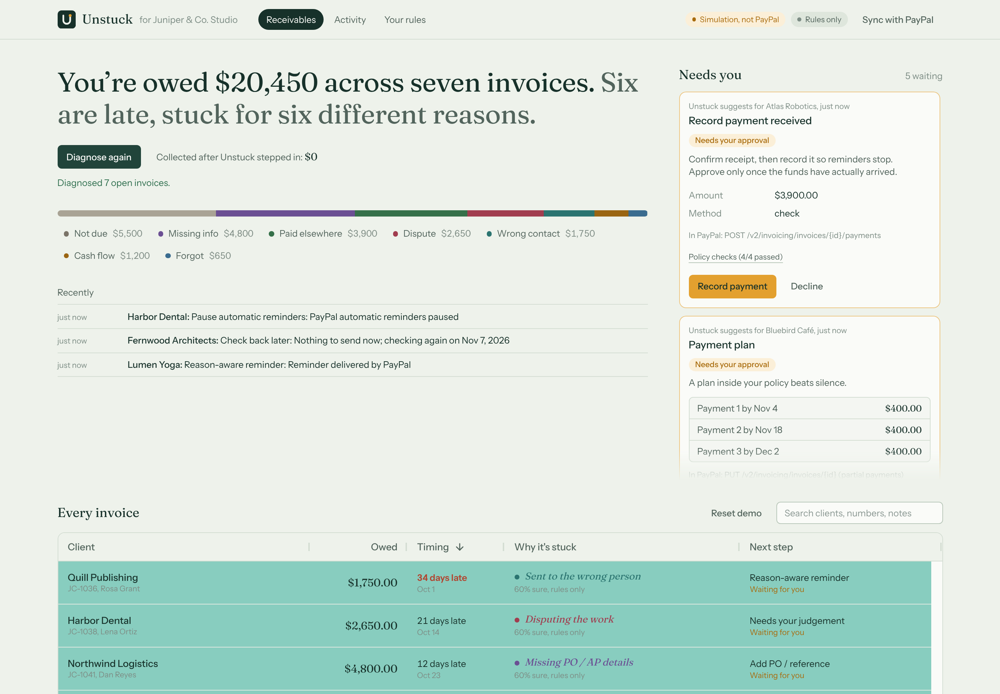
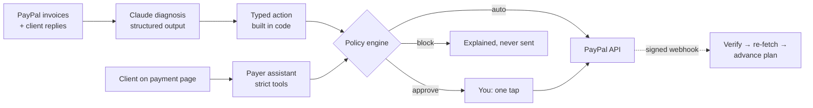
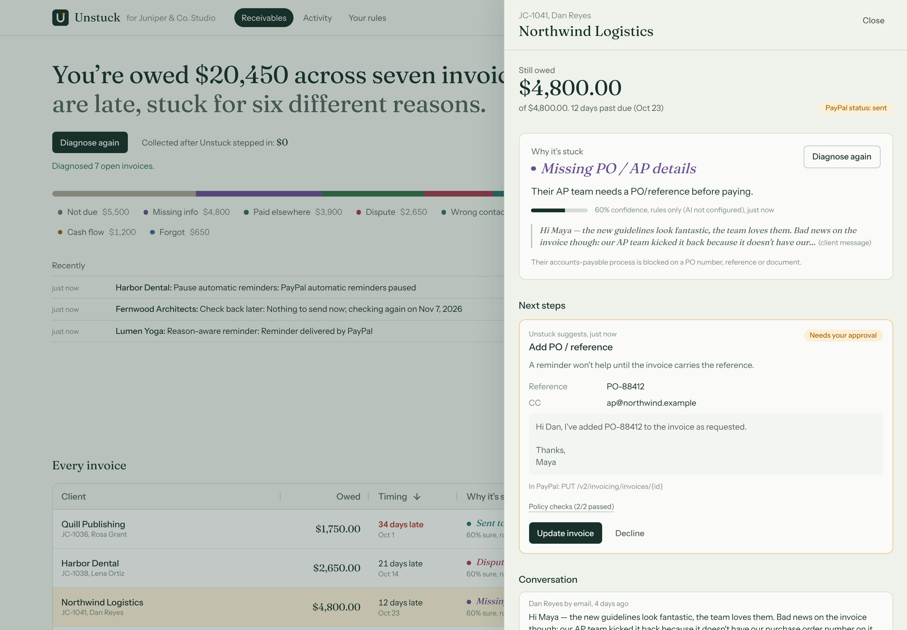
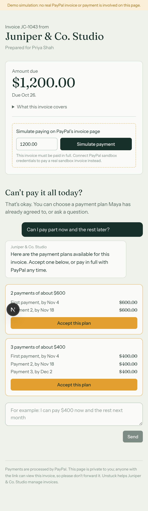
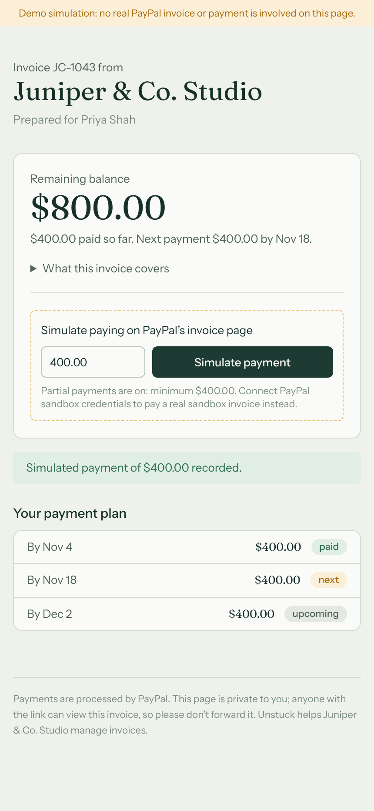

# Unstuck

**Find out why an invoice is stuck. Fix it inside PayPal. Keep the client.**

Unstuck is an AI receivables agent for small businesses that invoice with **PayPal Invoicing**. It reads each overdue invoice, its history and the client's replies. It works out *why* the invoice hasn't been paid, then fixes that cause with a native PayPal action, within rules the owner sets. Clients who can't pay in full get a private page where an assistant can offer only plans the owner has already allowed, and accepting one sets it up in PayPal on the spot.

Built for the [PayPal AI Hackathon 2026](https://paypalaihackathon.devpost.com/). MIT licensed.



---

## The problem

More than half of US small businesses have unpaid invoices outstanding, averaging **$17,500** each (QuickBooks 2025, n=2,487). **29%** of owners have delayed their own pay because clients paid late (Bluevine, March 2026, n=1,052). Yet only 19% charge late fees, and most freelancers fear losing the client if they chase (Ormsby Street, n=1,002).

Invoices get stuck for **different reasons**:

- The client's AP team needs a PO number.
- Cash is tight this month.
- The client disputes the work.
- The invoice reached someone who has left.
- A cheque is in the post.
- They simply forgot.

A reminder only fixes the last one, yet it's the only tool most small businesses have.

Sources and method notes: [`research/USER_PROBLEM_DISCOVERY.md`](research/USER_PROBLEM_DISCOVERY.md) · [`research/SOURCE_REGISTER.md`](research/SOURCE_REGISTER.md)

## What Unstuck does

| Why it's stuck | What Unstuck does, in PayPal |
|---|---|
| Missing PO / AP details | Adds the PO to the invoice, CCs the AP inbox, PayPal re-sends it (`PUT /v2/invoicing/invoices/{id}`) |
| Cash is tight | Offers a payment plan within your rules, then turns on partial payments with the right minimum due (`PUT …` `partial_payment`) and moves the minimum as installments arrive |
| Slipped their mind | A short, specific reminder in your voice, delivered by PayPal (`POST …/remind`), sent automatically within your limits |
| Sent to the wrong person | Reminder to the new contact, after you confirm the address |
| Disputing the work | Pauses PayPal's automatic reminders (`POST …/cancel-reminders`), flags it for you with a suggested reply. No pressure |
| Says it's paid | Records the cheque or transfer once you confirm it arrived (`POST …/payments`) |
| Large, first-time invoice | Suggests a small early-payment discount as a PayPal rule that expires on its own (`POST …/conditional-rules`) |

**The agent proposes. The policy engine decides what's allowed. PayPal executes. You stay in control.**

## How it works



1. **Sync** pulls invoices from PayPal Invoicing.
2. **Diagnose**: Claude (`claude-opus-5-5`, structured outputs) reads invoice facts, payment history and client messages, and returns a reason from a fixed taxonomy, with evidence quotes, a confidence score and a recommended action.
3. **Build in code**: server code turns the recommendation into a typed action. Plan maths, discount caps, validated PO numbers and emails all come from code, and the payment-page link is appended by code.
4. **Policy**: every action is evaluated (`auto` / `approve` / `block`) with itemised checks you can read on the card.
5. **Execute**: approved actions call PayPal with `PayPal-Request-Id` idempotency. Receipts (HTTP status, `paypal-debug-id`) go into the audit log.
6. **Payer page**: every reminder links to a private page. Clients can pay with PayPal, or ask the assistant for a plan. The assistant can only *request* plans from the policy engine, and the client must click **Accept this plan**.
7. **Webhooks**: `INVOICING.INVOICE.PAID` is verified with PayPal, deduplicated, and triggers a re-fetch. Plans advance automatically.

## Screens

| Owner: invoice drawer | Client: payment page | Client: plan in progress |
|---|---|---|
|  |  |  |

The screenshots were taken in simulation mode. See *Modes* below.

## PayPal integration

Built on **PayPal Invoicing v2**. Ten operations are used: OAuth2, list/get, `remind`, full-replacement `PUT` (partial payments, minimum due, reference, CC), `conditional-rules`, `payments`, `cancel-reminders`, create/send (seeding), webhook verification and webhook registration. Request shapes follow PayPal's own [Agent Toolkit](https://www.npmjs.com/package/@paypal/agent-toolkit) 1.11.0. Details: [`docs/PAYPAL_INTEGRATION.md`](docs/PAYPAL_INTEGRATION.md).

## AI

- **Diagnosis agent**: Claude structured outputs, sanitised, converted to actions in code, policy-gated, with a rules-only fallback.
- **Payer agent**: a tool loop with four strict tools (`get_payment_options`, `propose_payment_plan`, `record_promise_to_pay`, `send_to_owner`). It has no tools that change money, so it has nothing to misuse.
- Prompt-injection posture, approval matrix, audit trail and cost controls: [`docs/AI_SYSTEM_DESIGN.md`](docs/AI_SYSTEM_DESIGN.md).

## Sponsor technology

- **AG Grid** (Community, v36) powers the receivables board and the activity log. It uses custom React cell renderers (reason phrases, aging, plan progress, next step), an external filter driven by the reason strip, quick-filter search, a pinned totals row, stable row ids with change flashing, tooltips, and wrapped auto-height audit rows.
- **Render**: a one-click Blueprint (`render.yaml`) with a health check.

## Run it

**Requirements:** Node 20.9 or later (22 recommended).

```bash
npm install
npm run dev
```

Open <http://localhost:3000>. With no credentials, Unstuck starts in **simulation** and loads a demo studio with seven stuck invoices.

### Modes

| | No keys | With keys |
|---|---|---|
| PayPal | **Simulation**: a local stand-in that follows the Invoicing contract. Labelled "Simulation, not PayPal" everywhere, and no PayPal calls are made | **PayPal sandbox**: real invoices, real reminders, real partial payments |
| AI | **Rules only**: keyword heuristics and templates, labelled | **Claude** diagnosis and payer assistant |

### Connect the PayPal sandbox and Claude

```bash
cp .env.example .env.local
```

Fill in `PAYPAL_CLIENT_ID`, `PAYPAL_CLIENT_SECRET`, `DEMO_PAYER_EMAIL` and `ANTHROPIC_API_KEY`, then:

```bash
npm run check:sandbox
```

```bash
npm run seed:sandbox
```

```bash
npm run dev
```

The seeder creates 12 real sandbox invoices. For webhooks, see [`docs/PAYPAL_INTEGRATION.md`](docs/PAYPAL_INTEGRATION.md#sandbox-setup). Without them, use **Sync with PayPal** after paying.

### Environment variables

Documented in [`.env.example`](.env.example). The key ones are `PAYPAL_CLIENT_ID`, `PAYPAL_CLIENT_SECRET`, `PAYPAL_WEBHOOK_ID`, `DEMO_PAYER_EMAIL`, `ANTHROPIC_API_KEY`, `ANTHROPIC_MODEL`, `APP_BASE_URL` and `OWNER_BASIC_AUTH`.

## Tests

```bash
npm run lint
```

```bash
npm test
```

```bash
npm run build && npm run test:contract
```

```bash
UNSTUCK_MODE=simulation npm run dev
```

Then, in a second terminal:

```bash
npm run test:e2e
```

- `npm run lint`: TypeScript, strict.
- `npm test`: 40 unit and flow tests (policy, PayPal client, AI paths with a scripted model).
- `npm run test:contract`: 23 checks of the live PayPal code path against a strict mock PayPal over HTTP.
- `npm run test:e2e`: 14 browser checks of the full journey.

Latest results: [`qa/TEST_RESULTS.md`](qa/TEST_RESULTS.md).

## Deploy

Render: **New → Blueprint** → this repo → fill in the secrets. Docker: see [`docs/DEPLOYMENT_ARCHITECTURE.md`](docs/DEPLOYMENT_ARCHITECTURE.md).

## Architecture and docs

| | |
|---|---|
| [`docs/ARCHITECTURE.md`](docs/ARCHITECTURE.md) | Components, data flow, decisions |
| [`docs/API_SPECIFICATION.md`](docs/API_SPECIFICATION.md) | Every endpoint and action type |
| [`docs/DATABASE_DESIGN.md`](docs/DATABASE_DESIGN.md) | Schema |
| [`docs/SECURITY_DESIGN.md`](docs/SECURITY_DESIGN.md) | Threat model and controls |
| [`research/`](research/) | Hackathon research, idea scoring (15 ideas), problem statement, product requirements |

**Stack:** Next.js 16 · React 19 · TypeScript · Tailwind CSS 4 · AG Grid 36 · SQLite (better-sqlite3) · Anthropic SDK · PayPal REST (Invoicing v2, Webhooks) · Vitest · Playwright.

## Security

- Secrets are read from environment variables only.
- Every money change passes a deterministic policy, uses integer cents, and is re-checked against PayPal's current state before execution.
- Writes are idempotent.
- Webhooks are signature-verified and deduplicated.
- The payer page uses a 144-bit token.
- CSRF checks run on every owner mutation.
- The app runs against the sandbox only.

More in [`qa/SECURITY_AUDIT.md`](qa/SECURITY_AUDIT.md).

## Honest status

- ✅ Verified in this repo: the full journey in simulation (browser E2E), and the live PayPal code path against a strict mock (contract test).
- ⏳ Pending: a run against the real PayPal sandbox and real Claude. The build environment could not reach `api-m.sandbox.paypal.com` and had no keys. The steps above take about five minutes with credentials.

## Roadmap

- Per-client learning: which remedy works for which reason.
- Recurring invoices and failed subscription renewals.
- An MCP server exposing the policy-gated tools to any agent.
- Agent-to-agent settlement with clients' AP agents.
- Multi-user accounts.

## Licence

[MIT](LICENSE)
