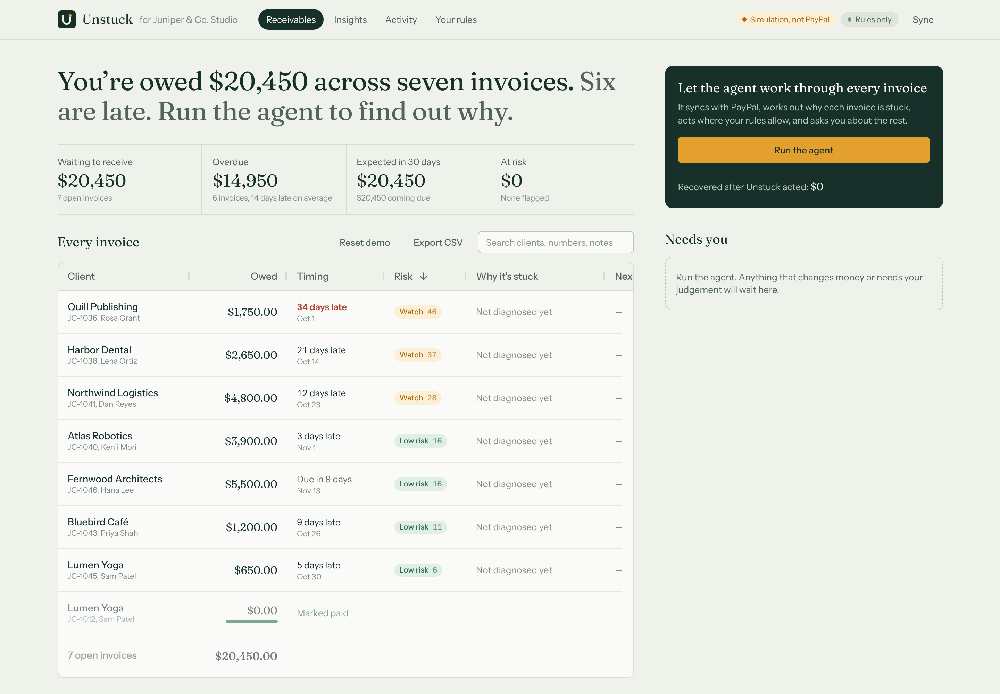
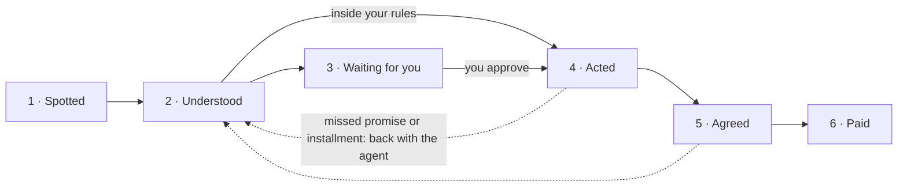
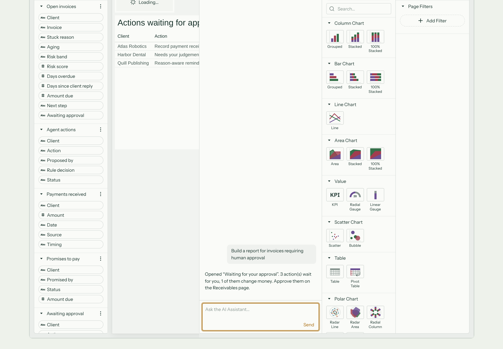
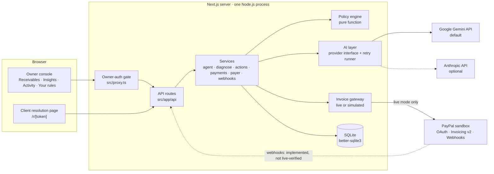
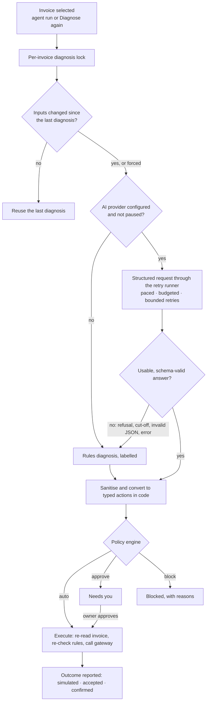
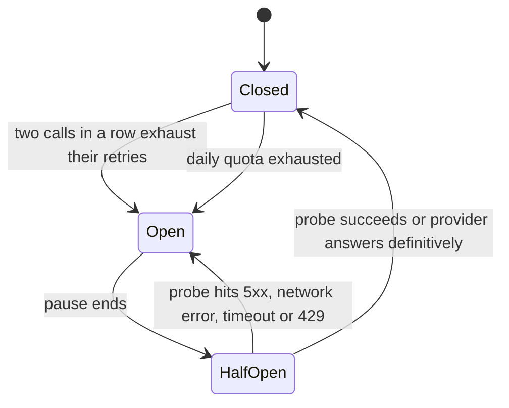
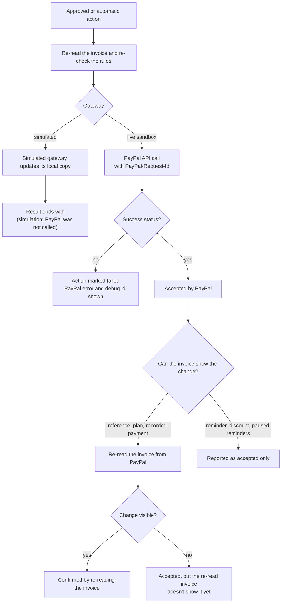

<div align="center">


# Unstuck

### Every unpaid invoice has a reason. Unstuck finds it, and resolves it with your client, inside PayPal.

An AI receivables-resolution agent for small businesses that invoice with **PayPal Invoicing**.

[](LICENSE)
[](package.json)
[](package.json)
[](#paypal-integration)
[](docs/AI_PROVIDERS.md)
[](#ag-grid-and-ag-studio)
[](https://paypalaihackathon.devpost.com/)

**[Quick start](#quick-start)** · **[How it works](#how-it-works)** · **[Architecture](#architecture)** · **[PayPal integration](#paypal-integration)** · **[Safety](#safety-trust-and-boundaries)** · **[Docs](#documentation)**

</div>

---

Most invoicing tools can tell you **which** invoices are overdue. Unstuck works out **why** each one is stuck: a missing purchase-order number, a client short on cash, a dispute about the work, the wrong contact, a cheque in the post, a broken promise, or a client who simply forgot. It then applies the remedy that fits the cause as a **change to the PayPal invoice**, within rules you set, and follows the invoice until PayPal reports the money.

> **The agent proposes. Your rules decide what's allowed. PayPal executes. You stay in control.**

<table>
<tr>
<td width="33%" valign="top">

**Understands the blocker**<br>
An evidence-backed diagnosis keeps what the client *said* (quoted) apart from what the agent *infers*, and says so when it can't tell.

</td>
<td width="33%" valign="top">

**Acts as PayPal state, not just email**<br>
Adds the missing PO, sets up partial payments, pauses reminders during a dispute, records a cheque. Deterministic rules decide what runs on its own.

</td>
<td width="33%" valign="top">

**Reports outcomes honestly**<br>
"Accepted by PayPal" and "confirmed by re-reading the invoice" are different things, and simulated actions say plainly that PayPal was not called.

</td>
</tr>
</table>

**Try it in two minutes, with no keys:** `npm install`, then `npm run dev`. Open <http://localhost:3000> and press **Run the agent**. The app runs a clearly labelled simulation with rules-only AI and makes no PayPal calls ([Quick start](#quick-start)).

<p align="center">
  
  <br>
  <sub>The owner console before an agent run (labelled simulation, rules-only AI, fictional demo data).</sub>
</p>

## Contents

- [The problem](#the-problem)
- [The Unstuck approach](#the-unstuck-approach)
- [How it works](#how-it-works)
- [Capabilities](#capabilities)
- [Architecture](#architecture)
- [AI architecture and reliability](#ai-architecture-and-reliability)
- [PayPal integration](#paypal-integration)
- [Safety, trust and boundaries](#safety-trust-and-boundaries)
- [AG Grid and AG Studio](#ag-grid-and-ag-studio)
- [Quick start](#quick-start)
- [Configuration reference](#configuration-reference)
- [Testing and verification](#testing-and-verification)
- [Repository structure](#repository-structure)
- [Limitations and roadmap](#limitations-and-roadmap)
- [Hackathon context and credits](#hackathon-context-and-credits)
- [Documentation](#documentation)
- [Licence](#licence)

## The problem

Late payment is a routine, expensive part of running a small business:

- **56%** of US small businesses have unpaid invoices outstanding. Those that do are owed **$17,500** on average ([QuickBooks, 2025](https://quickbooks.intuit.com/r/small-business-data/small-business-late-payments-report-2025/), n = 2,487).
- **29%** of owners have delayed their own pay because clients paid late, yet only **19%** charge late fees ([Bluevine, 2026](https://www.bluevine.com/newsroom/late-payment-gap-survey-press-release), n = 1,052).

Sources and caveats are in [`research/PHASE_2_COMPETITIVE_RESEARCH.md`](research/PHASE_2_COMPETITIVE_RESEARCH.md).

**Why reminders alone don't work.** An invoice stalls for a specific reason, and a generic "friendly reminder" fixes only one of them: the client who forgot. It does nothing for an accounts-payable team that can't process the invoice without a PO number, or a client who wants to pay but can't pay it all this month. A stream of reminders also risks the relationship, so many owners stop chasing. Resolving a late invoice needs **context** (what the client said, what has already been tried), **prioritisation** (which invoices need attention first) and the **right action** for the cause.

> [!NOTE]
> **An illustrative example.** This is the app's built-in demo scenario. Every name in it is fictional.
>
> Maya runs a two-person design studio and is owed **$21,700** across eight PayPal invoices; seven are late. A tracker would show seven red rows. In fact:
> - **Northwind Logistics:** the AP team bounced the invoice because it has no purchase-order number. The fix is to add `PO-88412` and re-send the invoice, not to send a reminder.
> - **Bluebird Café:** the owner wants to pay but is short on cash. A payment plan within Maya's limits resolves it.
> - **Harbor Dental:** the client disputes the work. Automated pressure should stop, and Maya needs the evidence.
> - **Kestrel Media:** promised to pay by a date that has passed. The broken promise needs a specific follow-up.

## The Unstuck approach

| A receivables tracker | Unstuck |
|---|---|
| Lists overdue invoices | Explains **why** each one is stuck, with the client's own words as evidence |
| Sends the same reminder to everyone | Picks a **cause-specific remedy**: PO added, payment plan, paused reminders, recorded payment… |
| Leaves every decision to you | Acts on its own **only inside your rules**; anything that changes money waits for your OK |
| Stops at "reminder sent" | Follows the invoice **through to payment**, and brings missed promises back to the agent |
| Reports success when the API returns 200 | Separates **accepted**, **confirmed on re-read** and **paid**, and labels simulated results |

**Remedies by cause.** In live (sandbox) mode, each remedy is a PayPal Invoicing v2 operation:

| Why it's stuck | What Unstuck does | PayPal operation |
|---|---|---|
| Missing PO / AP details | Puts the reference on the invoice, CCs the AP inbox, has PayPal re-send it | `PUT /v2/invoicing/invoices/{id}` |
| Cash is tight | A payment plan as PayPal partial payments, with a minimum due that advances as installments are paid | `PUT /v2/invoicing/invoices/{id}` (partial payment) |
| Slipped their mind | A short, specific reminder in the owner's voice, automatic within the owner's limits | `POST …/{id}/remind` |
| Sent to the wrong person | A reminder to the new contact, after owner approval | `POST …/{id}/remind` |
| Disputing the work | Pauses PayPal's automatic reminders and hands the evidence to the owner | `POST …/{id}/cancel-reminders` |
| Says it's paid (cheque in the post) | Records the payment, only after the owner confirms it arrived | `POST …/{id}/payments` |
| Large invoice, worth an incentive | An early-payment discount that expires on its own (owner approval required) | `POST …/{id}/conditional-rules` |

## How it works

**Run the agent** performs one observable pass. Every step is recorded and shown live in *Last agent run*.

1. **Sync.** Invoices are read from PayPal (or from the simulation), which stays the source of truth.
2. **Spot.** Open invoices are ranked by a transparent risk score. Follow-ups that need no AI come first: plan installments coming due, promises to pay that were missed.
3. **Gather.** Each invoice's facts, payment history, reminder history, active plan and recent client messages are assembled.
4. **Diagnose.** The AI provider (Gemini by default) returns a schema-constrained diagnosis: the reason (one of nine), the evidence, what it infers, a recommended action, the expected outcome, risks and alternatives. Unchanged invoices reuse their last diagnosis.
5. **Validate.** Unstuck re-validates and sanitises the answer, then converts the recommendation into typed actions **in code**. Plan maths, discount caps, PO formats, email addresses and links are never taken from the model. If the AI is unavailable or its answer is unusable, a labelled rules diagnosis is used instead.
6. **Check the rules.** A deterministic policy engine classifies each action as **auto**, **needs your approval** or **blocked**, with every check itemised on the action card.
7. **Approve.** Anything waiting for you appears under *Needs you*. You can approve or reject it, and edit a reminder's wording first.
8. **Act and verify.** Right before executing, Unstuck re-reads the invoice and runs the rules again, so a stale approval can't fire. Where the invoice can show the change, it re-reads the invoice afterwards to confirm it.
9. **Report honestly.** The result says exactly what is known: simulated, accepted by PayPal, or confirmed on re-read.

Clients take part too. Every reminder links to a private **resolution page** where the client can explain what's wrong, ask for a payment plan or promise a date. An assistant there can only surface plans the policy engine allows. Accepting one applies it to the PayPal invoice when it is within your rules, or sends it to you when it isn't.

**The resolution loop.** Every open invoice sits in exactly one stage, computed from recorded facts (diagnoses, action results, plans, promises and PayPal's status):



## Capabilities

| Capability | What it does | Status |
|---|---|---|
| **Receivables dashboard** | Amount owed, overdue, a 30-day outlook grouped by *why* money is expected (plan, promise, in transit, coming due), money at risk, and the resolution loop | Implemented |
| **Receivables board** (AG Grid) | Risk-sorted grid with stuck reason, timing, transparent risk, next step; reason filter, quick search, pinned totals, CSV export, change flashing | Implemented |
| **AI invoice diagnosis** | Structured diagnosis with quoted evidence, inference, recommendation, expected outcome, risks and alternatives; reuse until inputs change; *Diagnose again* to force | Implemented (Gemini default, Claude optional); rules fallback |
| **Rules-only diagnosis** | Keyword heuristics and templates when no AI key is set or the AI fails, labelled as such | Implemented |
| **Policy engine and approvals** | Auto / approve / block for every action, with itemised checks; editable rules on *Your rules* | Implemented |
| **PayPal actions** | Reminder, reference/PO update and re-send, partial-payment plan, early-payment discount, recorded payment, paused reminders | Implemented; verified against a strict mock and in simulation; live sandbox writes not yet exercised ([details](#verification-status)) |
| **Client resolution page** | Private page per invoice; tool-using assistant limited to four server-validated tools; in-policy plans; promises to pay; escalation to the owner | Implemented (assistant uses the AI provider when configured, rules replies otherwise) |
| **Payment-plan tracking** | Installments advance PayPal's minimum due; installments coming due get reminders; missed ones return to the agent | Implemented; payments arrive by webhook or sync |
| **Outcome verification** | Live: accepted vs confirmed on re-read; simulation: explicit "PayPal was not called" | Implemented |
| **Webhooks** | Signature verification with PayPal, deduplication, re-read of the invoice (payload never trusted) | Implemented and mock-tested; **not live-verified** |
| **Insights** (AG Studio) | Receivables report over five read-only tables; *Build your own report*; the *Unstuck Insights* agent | Implemented; built-in Studio agents need an AI key |
| **Activity log** (AG Grid) | Every decision, PayPal call (with debug id), AI call evidence and webhook | Implemented |
| **AI provider resilience** | One retry runner: pacing, daily budget, backoff, quota pause, circuit breaker; *AI: Gemini paused* badge | Implemented; tested against a stubbed network |
| **Simulation mode** | Fictional demo studio, simulated gateway, simulated client payments, one-click *Reset demo* | Implemented |
| **Scheduled runs** | `POST /api/agent/run` with a bearer token (e.g. from a cron job) | Implemented; no scheduler is included |

<details>
<summary><b>Screenshots</b> (labelled simulation, rules-only AI, fictional data)</summary>

<br>

| Invoice diagnosis | Client page: options with consequences |
|---|---|
|  |  |

| Insights (AG Studio) | The Unstuck Insights agent in AG Studio's AI panel |
|---|---|
|  |  |

The screenshots were captured before the final wording pass, so a few small labels differ from the current build. For example, the Stage 4 hint now reads "Unstuck or you acted (labelled when simulated)".

</details>

## Architecture

Unstuck is a single **Next.js 16** application (App Router) running as one Node.js process, with **SQLite** for local state. PayPal stays the source of truth for invoices and payments.



| Component | Location | Responsibility |
|---|---|---|
| Owner console | `src/app/page.tsx`, `insights/`, `activity/`, `policy/`, `src/components/` | Dashboard, resolution loop, AG Grid board, invoice drawer, action cards, Insights, Activity, rules editor |
| Client resolution page | `src/app/r/[token]/`, `src/components/PayerPage.tsx` | Public page per invoice, reached by an unguessable token |
| Owner-auth gate | `src/proxy.ts` | Optional HTTP Basic auth for the owner console and owner APIs; fails closed in production with live PayPal |
| API routes | `src/app/api/` | Board, sync, agent run, diagnose, actions, invoices, payer, policy, insights, webhooks, health, demo reset |
| Services | `src/lib/services/` | The agent run, diagnosis, action execution and verification, payment-plan tracking, payer flows, webhook processing, read models |
| Policy engine | `src/lib/policy.ts` | Pure, exhaustively tested rules: auto / approve / block, plan maths, outbound-text checks |
| AI layer | `src/lib/ai/` | Provider interface, Gemini and Claude adapters, the retry runner, diagnosis, payer assistant, AG Studio chat bridge |
| Invoice gateway | `src/lib/paypal/` | `LivePayPalGateway` (OAuth client, Invoicing v2, webhook verification) and `SimulatedGateway` (same interface, no network) |
| Persistence | `src/lib/db.ts` | SQLite tables for invoices, messages, diagnoses, actions, plans, offers, events, settings, webhook events, agent runs and steps |
| Concurrency | `src/lib/locks.ts` | In-process per-invoice locks for diagnoses, actions, approvals and payment updates |

<details>
<summary><b>Technology stack</b></summary>

<br>

| Layer | Technology |
|---|---|
| Application | Next.js 16 (App Router, Turbopack dev), React 19, TypeScript (strict), Tailwind CSS 4 |
| Data grid and analytics | AG Grid Community 36, AG Studio 3 (`ag-studio`, `ag-studio-react`) |
| AI | Google Gen AI SDK (`@google/genai`), Gemini `gemini-3.5-flash-lite` by default; Anthropic SDK (optional) |
| Payments | PayPal REST APIs: OAuth 2.0, Invoicing v2, Webhooks (sandbox) |
| Persistence | SQLite via `better-sqlite3` |
| Validation | Zod |
| Testing | Vitest; a strict mock PayPal over HTTP; Playwright for the browser journey (installed separately) |
| Hosting (optional) | Render Blueprint (`render.yaml`) |

</details>

## AI architecture and reliability

### Two AI roles, one provider interface

| Role | What it does | Interface method |
|---|---|---|
| **Diagnosis agent** (owner side) | Decides why one invoice is unpaid and recommends the next step, as structured JSON | `generateStructured` |
| **Payer assistant** (client side) | Helps a client find an acceptable option, using four strict tools: `get_payment_options`, `propose_payment_plan`, `record_promise_to_pay`, `send_to_owner` | `chatTurn` |

Both roles go through one provider-independent interface (`src/lib/ai/providers/`). The provider is chosen with `AI_PROVIDER`:

- **Gemini (default):** the official `@google/genai` SDK; `responseJsonSchema` for structured output; function calling with thought signatures echoed back; endpoint pinned to the Gemini Developer API.
- **Claude (optional):** the official Anthropic SDK; structured output via its zod helper; server-side refusal fallbacks.
- **None:** deterministic rules, labelled in the UI.

**The model never touches money or PayPal directly.** Its output is validated against Unstuck's own schema and sanitised: confidence clamped, lengths trimmed, PO, email, date and amount formats checked. It is then converted to typed actions by code and passed through the policy engine. Client messages are wrapped as untrusted data in the prompt. The model is instructed to quote clients verbatim. The evaluation harness and `npm run verify:ai` check that client quotes really appear in the conversation; the running app displays the quotes as returned.



### Reliability

Gemini can be temporarily overloaded (HTTP 503) or rate-limited (HTTP 429). The SDK's own retry loops are **switched off** in both adapters, because they would bypass Unstuck's pacing and budget. Every retry goes through one runner, `src/lib/ai/reliability.ts`.

| Situation | Behaviour |
|---|---|
| **Every HTTP attempt** | Waits for a pacing slot (`GEMINI_MAX_RPM`, default 10 per minute), is re-checked against the circuit breaker, and is charged to the daily budget (`AI_DAILY_CALL_LIMIT`, default 500 attempts). Each attempt times out after 60 s |
| **503 / 5xx / network error** | Retried with exponential backoff and jitter. Diagnosis: up to 3 attempts within 120 s. Chat turns: up to 2 attempts within 30 s |
| **429, per-minute limit** | Retried once, after Google's `RetryInfo` delay (clamped to 60 s; 60 s if absent); chat turns retry only if that wait is 20 s or less. Every other Gemini request is pushed back too |
| **429, daily quota** | Never retried. Gemini calls pause for Google's reset hint, capped at one hour, or 30 minutes without one |
| **Auth, unknown model, malformed request, our own timeout** | Never retried; classified and shown |
| **Repeated failures** | After two calls in a row run out of retries, a circuit breaker pauses the provider for 2 minutes. The header shows *AI: Gemini paused*; nothing is sent or charged while paused |
| **Recovery** | When the pause ends, the first new call becomes a single probe. Success, or a definite answer from Gemini, closes the breaker; another failure pauses again |
| **Waiting callers** | Interactive chat turns never queue more than 25 s behind background diagnoses; background diagnoses no more than 10 minutes. Both fall back to rules instead |
| **Untrusted hints** | `Retry-After` and `RetryInfo` values are sanitised and clamped before they affect any wait |



**Fallback.** Whatever happens, the invoice still gets a diagnosis: a rules diagnosis, clearly labelled with the reason (*Rate limited*, *Request failed*, *Invalid response*, *Daily limit reached*). A fallback is never presented as an AI diagnosis. A failed invoice is not retried automatically for 30 minutes, except when nothing was ever sent.

**Concurrency.** Diagnoses, action proposals, approvals and payment updates are serialised **per invoice** with in-process locks. Overlapping work (an agent run, *Diagnose again* and an approval) therefore can't send a client two reminders, execute an action twice, or overwrite another change to the same invoice. Only one agent run executes at a time.

**What is verified.** The pipeline, adapters, retry runner and breaker are covered by unit tests that drive the real Gemini SDK against a stubbed network. Real-provider verification is a separate, owner-run step (`npm run verify:ai`); see [Verification status](#verification-status). No AI accuracy figure for Gemini is claimed yet. Full detail: [`docs/AI_PROVIDERS.md`](docs/AI_PROVIDERS.md) · [`docs/AI_SYSTEM_DESIGN.md`](docs/AI_SYSTEM_DESIGN.md).

## PayPal integration

Unstuck integrates the **PayPal Developer Platform REST APIs** in the **sandbox** environment. The hackathon build refuses production PayPal, by environment and by host.

| Area | Implementation |
|---|---|
| **Authentication** | OAuth 2.0 client credentials (`POST /v1/oauth2/token`) with your sandbox REST app's Client ID and Secret; token cached in memory |
| **Reliability** | 20 s timeout per request. Reads, and writes that carry a `PayPal-Request-Id`, are retried up to twice on network errors, 429 and 5xx. Every write carries a `PayPal-Request-Id` (`unstuck-<action id>`), so retries and double clicks are idempotent at PayPal |
| **Sync** | `GET /v2/invoicing/invoices`, up to 5 pages of 100, then full detail (`GET …/{id}`) for up to 100 non-draft invoices. Runs on first load of an empty database, from **Sync**, and at the start of every agent run |
| **Actions** | `remind`, full-replacement `PUT` (reference, CC, partial payments, minimum due; read-only fields stripped), `conditional-rules`, `payments`, `cancel-reminders`. The demo seeder also uses create and send |
| **Payment plans** | A plan becomes PayPal partial payments with a minimum due. When a payment arrives (webhook or sync), Unstuck re-reads the invoice and moves the minimum due to the next installment |
| **Webhooks** | `POST /api/webhooks/paypal`: signature verified with `POST /v1/notifications/verify-webhook-signature` (needs `PAYPAL_WEBHOOK_ID`), deduplicated by event id, and treated as a signal only: the invoice is re-read from PayPal. Only accepted when connected to the sandbox |

### Accepted, confirmed, recorded, collected

These words mean different things, and Unstuck uses them precisely:

| Term | What it means | What it does **not** mean |
|---|---|---|
| **Simulated** | The simulated gateway changed its own copy. Results end with "(simulation: PayPal was not called)" | Anything happened at PayPal |
| **Accepted by PayPal** | The API returned a success status for the request | That the client received, read or acted on anything. A reminder is "accepted for sending": PayPal doesn't report delivery |
| **Confirmed** | Unstuck re-read the invoice from PayPal and the change is there (reference, payment plan, recorded payment) | That the client has paid |
| **Payment recorded** | PayPal's invoice shows a paid amount: a PayPal payment, or an off-PayPal payment the owner confirmed and Unstuck recorded | That funds have settled in a bank account |
| **Collected after Unstuck acted** | Payments PayPal (or the simulation) reports after an Unstuck action | Proof that the action caused the payment: it is labelled as timing, not causation |



**Simulation outcomes that aren't PayPal actions.** Some results never involve PayPal in either mode: *wait* ("check back later"), *escalate to owner* and policy blocks. They don't carry the "PayPal was not called" label, because no PayPal action was attempted. Every simulated action that stands in for a PayPal call does carry it.

### Verification status

| What | Status |
|---|---|
| Full journey in simulation | Verified by the browser test (last recorded: 22/22 checks) |
| Live PayPal code path (OAuth, sync, every action, webhooks, owner auth) | Verified against a **strict mock PayPal over HTTP** (`npm run test:contract`, last recorded: 26/26 checks) |
| Real PayPal sandbox, read-only | **Owner-reported** from a local run: OAuth, Invoicing and Webhooks APIs reachable; 13 seeded invoices (8 sent, 5 marked as paid); no webhook registered. No evidence file is committed yet |
| Real sandbox **writes** made by Unstuck's actions | **Not yet exercised**: reminders, PO updates, plans and recorded payments have run only against the mock and in simulation |
| Live webhook registration and delivery | **Not verified**: registration needs a public HTTPS URL and a PayPal write |
| Real Gemini diagnoses | **Owner-reported** from a local run, with intermittent HTTP 503s. The evidence file from `npm run verify:ai` is pending |
| Gemini evaluation accuracy | **Not yet run.** Rules-only baseline: 14/26 correct, 12 abstentions, 0 forbidden actions, 0 safety violations |

Nothing in this repository claims a real PayPal transaction or a real AI-provider result until its evidence is recorded in [`qa/`](qa/).

## Safety, trust and boundaries

| Boundary | How it is enforced |
|---|---|
| **Sandbox only** | `PAYPAL_ENV` must be `sandbox`, and a production PayPal host in `PAYPAL_API_BASE` is refused. Nothing here touches real money |
| **Simulation by default** | Without PayPal credentials, or with `UNSTUCK_MODE=simulation`, a simulated gateway is used and the header says **Simulation, not PayPal** |
| **Human approval** | Agent-proposed money changes (plans, discounts, recorded payments) always need the owner. Reminders to new recipients, reminders sent too soon and messages failing content checks wait for approval. Disputed invoices get no automated pressure |
| **Outbound text checks** | Agent-written reminders that contain foreign links, email addresses, other payment methods or legal or threatening language never go out automatically |
| **Execution-time re-check** | Before any action runs, the invoice is re-read from PayPal and the rules are run again. An approval that is no longer valid is blocked, or returned for approval |
| **Bounded AI** | The model has no tools that cancel, discount or change amounts. Payer tool calls are allowlisted and schema-checked before running. Plans and amounts are computed by code. Client text is treated as untrusted data |
| **Honest outcomes** | Simulated, accepted, confirmed and paid are reported separately ([details](#accepted-confirmed-recorded-collected)) |
| **Credentials** | Keys and secrets stay server-side and are read from `.env.local` (git-ignored). The AI key is never sent to the browser. Error text is redacted for anything that looks like a key, and Gemini error messages are kept only in a short, redacted form |
| **Owner console** | `OWNER_BASIC_AUTH` protects the owner console and APIs. The public routes are the client page (`/r/*`, protected by an unguessable token), payer APIs, the webhook endpoint (signature-verified) and `/api/health` (no internal state). In production with PayPal connected and no password set, the console **refuses to serve** |
| **Request origin** | State-changing API routes accept only JSON and reject requests whose `Origin` is another site; the webhook endpoint relies on PayPal signature verification instead |
| **AI unavailable** | Labelled rules diagnoses; the circuit breaker stops calls to an unhealthy provider; nothing is presented as AI that isn't |
| **Concurrency** | Per-invoice locks plus PayPal idempotency keys; one agent run at a time |

> [!IMPORTANT]
> Unstuck is a hackathon prototype, not a production service. The locks, the AI request pacer, the circuit breaker and the AG Studio signature cache all live in **one server process**, and the database is a local SQLite file. It is designed to run as a **single instance**. No security certification or compliance claim is made. Details: [`docs/SECURITY_DESIGN.md`](docs/SECURITY_DESIGN.md) · [`qa/FINAL_SECURITY_AND_RELIABILITY_REPORT.md`](qa/FINAL_SECURITY_AND_RELIABILITY_REPORT.md) · [`qa/AI_SECURITY_REPORT.md`](qa/AI_SECURITY_REPORT.md).

## AG Grid and AG Studio

Unstuck uses AG Grid and AG Studio for the parts of the product that are about *seeing* the ledger: the working board, the audit trail and the analytics.

| Component | Product | What it does in Unstuck |
|---|---|---|
| **Receivables board** | AG Grid Community 36 | Custom React cell renderers (stuck reason, timing, transparent risk with factor breakdown, next step), risk-sorted by default, an external filter driven by the reason strip, quick search, pinned totals, CSV export and cell flashing when amounts change |
| **Activity log** | AG Grid Community 36 | Every decision, PayPal call (with PayPal debug id), AI call evidence and webhook, searchable |
| **Insights report** | AG Studio 3 | A themed receivables report over **five read-only tables** (open invoices, agent actions, payments received, promises to pay, approvals), with cross-filtering and a self-serve report builder (*Build your own report*) |
| **Unstuck Insights agent** | AG Studio Agent Framework | A custom agent built with `clientToolRunner` and registered with `createAiHarness`, running in AG Studio's AI panel. It routes a fixed set of receivables questions, such as "Which customers account for the highest overdue receivables?", to predefined reports. It answers with names and amounts computed from the data, opens the matching report page, and declines questions it has no report for. It uses **no LLM** |
| **Studio's built-in agents** | AG Studio Agent Framework | With an AI key, AG Studio's built-in agents also run, through a server-side adapter (`/api/insights/llm`), so the key never reaches the browser |

**Where to find the agent:** Insights → **Build your own report** → the **AI panel** on the right. The *Ask Insights* box at the top of the Insights page uses the same question routing **directly**, without the Agent Framework.

**Licence.** AG Studio works locally without a licence key, but its watermark may be visible. No key is included in this repository. To remove the watermark, set your own trial key in `NEXT_PUBLIC_AG_GRID_LICENSE_KEY`; it is exposed to the browser by design. Status and limits: [`qa/AG_STUDIO_SPONSOR_READINESS.md`](qa/AG_STUDIO_SPONSOR_READINESS.md).

## Quick start

### 1. Zero-credential simulation (recommended first run)

Requires **Node.js 20.9 or later** (22 recommended) and npm.

```bash
git clone https://github.com/Sidd927/PayPal-AI-Hackathon.git
```

```bash
cd PayPal-AI-Hackathon
```

```bash
npm install
```

```bash
npm run dev
```

Open <http://localhost:3000>. With no `.env.local`, a fictional demo studio with eight stuck invoices loads in **labelled simulation** with **rules-only** AI. **No PayPal or AI calls are made.** Then:

1. Press **Run the agent** and watch *Last agent run* and the resolution loop fill in.
2. Open **Northwind Logistics**: see the evidence, the inference and an approval card for adding `PO-88412`. Approve it; the result says PayPal was not called.
3. Open **Bluebird Café** → **Open as the client**. Ask "Can I pay part now and the rest later?", accept a plan, then **Simulate payment**. No real money moves.
4. Visit **Insights**, then **Build your own report**, and ask the agent in the AI panel.
5. **Reset demo** restores the scenario at any time.

The full judge walkthrough is in [`submission/DEMO_WALKTHROUGH.md`](submission/DEMO_WALKTHROUGH.md).

### 2. Add Gemini (real AI)

Create a key at <https://aistudio.google.com/apikey>, then create your local, git-ignored settings file:

```bash
cp .env.example .env.local
```

Set `GEMINI_API_KEY` in `.env.local`. `AI_PROVIDER` already defaults to `gemini`. Check the key and model in simulation, with PayPal blocked and a throwaway database:

```bash
npm run verify:ai
```

This makes real Gemini requests (about a dozen, more if a call is retried) and writes an evidence file under `qa/ai-verification/`. Restart `npm run dev`: the header now reads **AI: Gemini**. To use Claude instead, set `AI_PROVIDER=anthropic` and `ANTHROPIC_API_KEY` ([`docs/AI_PROVIDERS.md`](docs/AI_PROVIDERS.md)).

### 3. Connect the PayPal sandbox

1. In the PayPal Developer Dashboard, create a **sandbox** REST app and copy its Client ID and Secret into `.env.local` (`PAYPAL_CLIENT_ID`, `PAYPAL_CLIENT_SECRET`). Leave `PAYPAL_ENV=sandbox`.
2. Check connectivity. This is read-only: it gets a token, lists invoices and lists webhooks.

   ```bash
   npm run check:sandbox
   ```

3. Optional: give the sandbox the demo invoices. This **writes to your sandbox**: it creates and sends invoices. It is resumable and never duplicates or re-sends an existing invoice. Preview first with `--dry-run`, which is read-only, and skip this entirely if your sandbox is already seeded.

   ```bash
   npm run seed:sandbox -- --dry-run
   ```

   ```bash
   npm run seed:sandbox
   ```

4. Start the app with `npm run dev`. The header reads **PayPal sandbox**, and the first load of an empty database syncs your invoices.

> [!WARNING]
> In sandbox mode, actions inside your rules **run automatically** when you press **Run the agent**, for example a reminder sent through PayPal. Approving actions and using the client page also change sandbox invoices. To look without writing, use a fresh `DATABASE_PATH` and don't press anything; see [`submission/OWNER_VERIFICATION.md`](submission/OWNER_VERIFICATION.md) §4. `npm run check:sandbox -- --register-webhook` **creates a webhook** and needs a public HTTPS `APP_BASE_URL`.

`DEMO_PAYER_EMAIL` (optional) addresses one demo invoice to a sandbox *Personal* account so you can pay it as the buyer. PayPal won't send invoices to India-based recipients, so that account must be registered in another country.

## Configuration reference

All settings are environment variables, normally set in `.env.local` (git-ignored). Start from [`.env.example`](.env.example). **No variable is required for the simulation.**

<details>
<summary><b>Environment variables</b></summary>

<br>

| Variable | Purpose | Required? | Default / example |
|---|---|---|---|
| `PAYPAL_CLIENT_ID` | Sandbox REST app client ID. With the secret, switches from simulation to the PayPal sandbox | For sandbox mode | *(empty → simulation)* |
| `PAYPAL_CLIENT_SECRET` | Sandbox REST app secret (server-side only) | For sandbox mode | *(empty)* |
| `PAYPAL_ENV` | Must be `sandbox`; any other value is refused | No | `sandbox` |
| `PAYPAL_WEBHOOK_ID` | Webhook id for signature verification (from `check:sandbox -- --register-webhook`) | For webhooks | *(empty → webhooks rejected)* |
| `DEMO_PAYER_EMAIL` | Sandbox Personal account to receive the Bluebird demo invoice (not India-registered) | No | *(empty → fictional `.example` address)* |
| `AI_PROVIDER` | `gemini`, `anthropic` or `none` | No | `gemini` |
| `GEMINI_API_KEY` | Gemini Developer API key (server-side only) | For Gemini | *(empty → rules only)* |
| `GEMINI_MODEL` | Gemini model id | No | `gemini-3.5-flash-lite` |
| `GEMINI_MAX_RPM` | Unstuck's pacing of Gemini HTTP attempts per minute (retries included); not Google's quota | No | `10` |
| `ANTHROPIC_API_KEY` | Claude key, used only with `AI_PROVIDER=anthropic` | For Claude | *(empty)* |
| `ANTHROPIC_MODEL` | Claude model id | No | `claude-opus-5-5` |
| `ANTHROPIC_EFFORT` | Claude diagnosis effort: `low`, `medium` or `high` | No | `medium` |
| `AI_DAILY_CALL_LIMIT` | Unstuck's cap on AI HTTP attempts per day (retries count), any provider | No | `500` |
| `APP_BASE_URL` | Public base URL used in payment-page links put into PayPal reminders | No | `http://localhost:3000` |
| `DATABASE_PATH` | SQLite file location | No | `node_modules/.cache/unstuck/unstuck.db` |
| `OWNER_BASIC_AUTH` | `user:password` for the owner console; required in production with live PayPal | No | e.g. `maya:a-long-passphrase` |
| `UNSTUCK_MODE` | Set to `simulation` to force simulation even with PayPal credentials | No | *(empty)* |
| `ALLOW_DEMO_RESET` | Set to `false` to disable the demo-reset endpoint | No | `true` |
| `AGENT_RUN_TOKEN` | Bearer token that lets a scheduler call `POST /api/agent/run` when `OWNER_BASIC_AUTH` is set | No | *(empty)* |
| `NEXT_PUBLIC_AG_GRID_LICENSE_KEY` | AG Grid / AG Studio licence key; removes the watermark. Exposed to the browser | No | *(empty)* |

Advanced variables, not in `.env.example`:

| Variable | Purpose | Default |
|---|---|---|
| `PAYPAL_API_BASE` | Override the PayPal API host, for local mocks only. Production PayPal hosts are refused | PayPal sandbox |
| `UNSTUCK_AI` | Legacy: `off` is the same as `AI_PROVIDER=none` | *(empty)* |
| `UNSTUCK_DEMO_CONVERSATIONS` | Sandbox mode: attaches the fictional demo conversations to synced invoices whose numbers match the demo scenario (Unstuck's database only). `off` disables it | *(on)* |
| `DIAGNOSE_CONCURRENCY` | Parallel diagnoses for a bulk diagnosis (`POST /api/diagnose` without an invoice id); AI requests are still paced | `6` |
| `PORT` | Port for `npm run dev` / `npm start` | `3000` |
| `BASE_URL` | App URL for `npm run test:e2e` | `http://localhost:3000` |

</details>

## Testing and verification

| Command | What it checks | Needs | Network |
|---|---|---|---|
| `npm run lint` | TypeScript strict type check (`tsc --noEmit`) | Nothing | None |
| `npm test` | Unit, flow, agent, adversarial-model, reliability, concurrency, Insights, AI-provider and AI tool-security tests (Vitest). AI adapters run against scripted fakes or a stubbed network | Nothing | None |
| `npm run build` | Production build | Nothing | None |
| `npm run test:contract` | The **live PayPal code path** over HTTP against a strict local mock PayPal, with owner auth. Run after `npm run build` | A build | Localhost only |
| `npm run test:e2e` | Browser journey in simulation: resolution loop, missed promise, client plan, AG Studio questions and AI panel, mobile. Needs a running app and Playwright installed separately. **Overwrites `docs/screenshots/`** | Running app (simulation), Playwright | Localhost only |
| `npm run eval` | 26-scenario AI evaluation with strict scoring for the configured provider; writes `qa/eval/…` | AI key for a provider result (rules baseline otherwise) | AI provider |
| `npm run verify:ai` | 16 labelled checks against the real AI provider, in forced simulation with PayPal blocked and an isolated database; writes `qa/ai-verification/…` | AI key | AI provider only |
| `npm run check:sandbox` | Read-only sandbox check: OAuth, invoices, webhooks. `--register-webhook` writes | PayPal sandbox credentials | PayPal sandbox |
| `npm run seed:sandbox` | Creates and sends the demo invoices in the sandbox (**writes**); `--dry-run` is read-only | PayPal sandbox credentials | PayPal sandbox |
| `npm run test:all` | `lint`, `test`, `build` and `test:contract` in sequence | Nothing | Localhost only |

**Last recorded results.** These come from the release-candidate verification and were not re-run while this README was written: lint passed; `npm test` 276/276; build passed; `npm run test:contract` 26/26 (177 calls to the local mock); browser journey 22/22; rules-only evaluation 14/26 correct with 0 forbidden actions. Real-service status is in [Verification status](#verification-status). Owner-side steps are in [`submission/OWNER_VERIFICATION.md`](submission/OWNER_VERIFICATION.md).

## Repository structure

```text
src/
  app/                    Next.js App Router
    page.tsx              Receivables: the owner console
    insights/ activity/ policy/   Insights (AG Studio), Activity log, Your rules
    r/[token]/            Client resolution page (public, token-protected)
    api/                  JSON API: board, sync, agent, diagnose, actions, invoices, pay, policy, insights, webhooks, health, demo
  components/             React UI: Board, InvoiceDrawer, ResolutionLoop, ActionCard, PayerPage, Insights, ActivityLog…
    insights/             AG Studio report definitions and the Unstuck Insights agent
  lib/
    ai/                   Provider interface, Gemini and Claude adapters, retry runner, diagnosis, payer assistant, Studio chat
    paypal/               OAuth client, live gateway, simulated gateway, PayPal schemas
    services/             Agent run, diagnosis, actions, payments, payer, webhooks, board and insights read models
    demo/scenario.ts      The fictional demo studio
    policy.ts             Deterministic policy engine
    risk.ts               Transparent risk heuristic
    locks.ts              Per-invoice locks
    db.ts                 SQLite schema and repository
  proxy.ts                Owner-console auth gate
scripts/                  check-sandbox, seed-sandbox, verify-ai, contract-test, e2e, network guard
eval/                     26-scenario AI evaluation
tests/                    Vitest suites
docs/                     Architecture, API, data, AI, PayPal, security, deployment, design system; screenshots
qa/                       Audits, test results, AI evaluation and verification evidence
research/                 Problem, competitors, positioning, sponsor strategy
submission/               Devpost description, demo walkthrough, video script, owner runbook
render.yaml               Optional Render Blueprint
.env.example              Configuration template (no secrets)
```

## Limitations and roadmap

**Current implementation limits**
- **Single instance.** SQLite, the per-invoice locks, the AI pacer and circuit breaker, and the AG Studio signature cache are per process. Running several instances, or the dev server alongside `verify:ai` or `eval`, splits the pacing. After a restart, an AG Studio tool conversation may fail once with a clear error and must be restarted.
- **Sync limits.** Sync lists up to 500 invoices (5 pages of 100) and fetches full detail for up to 100 non-draft invoices.
- **Risk is a heuristic.** The risk score is a transparent sum of named factors, not a trained or predictive model.
- **Client messages are entered in the app.** There is no inbound email; replies come through the client page or are pasted in by the owner.

**External dependencies**
- **Gemini availability and quotas.** Gemini can return 503s; Google sets free-tier limits per project. `GEMINI_MAX_RPM` and `AI_DAILY_CALL_LIMIT` are Unstuck's own controls, not Google's quota. At a low pace (e.g. 3 per minute), an agent run over eight invoices takes several minutes.
- **PayPal.** Reminder delivery isn't reported by PayPal, so Unstuck reports reminders as accepted, never delivered. PayPal won't send invoices to India-based recipients.

**Sandbox and demo restrictions**
- **Sandbox only.** Production PayPal is refused by design.
- **Webhooks need a public URL.** Without a registered webhook, use **Sync** to pick up payments. Live webhook delivery has not been verified.
- **Simulated payments** exist only in simulation mode, to stand in for paying on PayPal's invoice page.

**Deployment**
- The Render Blueprint runs on an ephemeral disk on the free plan: the audit log and run history reset on restart, while PayPal stays the source of truth. A hosted demo has not been deployed.

**Roadmap (not implemented)**
- Publish the Gemini evaluation and verification evidence.
- Run and record the sandbox write path end to end: approved actions, client plans, a registered webhook.
- An email-forwarding inbox, so client replies arrive without copy-paste.
- Learn which remedies work for which reasons, once real outcomes exist.
- Expose the policy-gated actions as an MCP server, so a client's accounts-payable agent can settle through the same rules.

## Hackathon context and credits

Unstuck was built for the [PayPal AI Hackathon 2026](https://paypalaihackathon.devpost.com/). The repository's history starts on 4 November 2026.

- **PayPal:** PayPal Developer Platform REST APIs: OAuth 2.0, Invoicing v2, Webhooks (sandbox).
- **AI in the product:** Google Gemini via the Google Gen AI SDK (default); Anthropic Claude via the Anthropic SDK (optional).
- **Analytics and grids:** AG Grid Community and AG Studio, including the AG Studio Agent Framework.
- **AI in development:** the code and documentation were written with Claude Code, an AI coding assistant, under the project owner's direction.

No partnership, endorsement or award is implied.

## Documentation

| Topic | Document |
|---|---|
| Architecture, data flow and design decisions | [`docs/ARCHITECTURE.md`](docs/ARCHITECTURE.md) |
| AI providers: setup, limits, retries, statuses | [`docs/AI_PROVIDERS.md`](docs/AI_PROVIDERS.md) |
| AI system design: diagnosis, payer assistant, approval matrix | [`docs/AI_SYSTEM_DESIGN.md`](docs/AI_SYSTEM_DESIGN.md) |
| PayPal integration | [`docs/PAYPAL_INTEGRATION.md`](docs/PAYPAL_INTEGRATION.md) |
| API reference | [`docs/API_SPECIFICATION.md`](docs/API_SPECIFICATION.md) |
| Database | [`docs/DATABASE_DESIGN.md`](docs/DATABASE_DESIGN.md) |
| Security | [`docs/SECURITY_DESIGN.md`](docs/SECURITY_DESIGN.md) |
| Deployment | [`docs/DEPLOYMENT_ARCHITECTURE.md`](docs/DEPLOYMENT_ARCHITECTURE.md) |
| Design system | [`docs/DESIGN_SYSTEM.md`](docs/DESIGN_SYSTEM.md) |
| Judge walkthrough | [`submission/DEMO_WALKTHROUGH.md`](submission/DEMO_WALKTHROUGH.md) |
| Owner verification runbook | [`submission/OWNER_VERIFICATION.md`](submission/OWNER_VERIFICATION.md) |
| QA, audits and evaluation | [`qa/`](qa/) |
| Research | [`research/`](research/) |

## Licence

[MIT](LICENSE) © 2026 Siddhant Patil.
