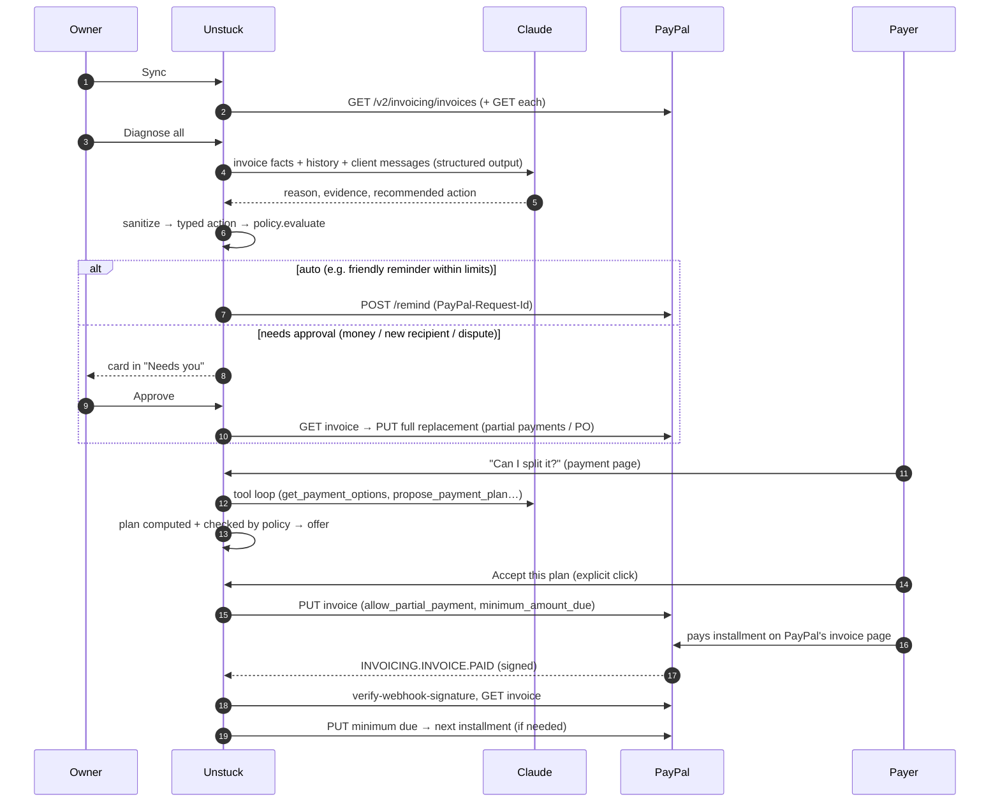

# Architecture

Unstuck is one Next.js 16 application (TypeScript, App Router) with a SQLite store. It talks to two external systems: **PayPal** (Invoicing v2, OAuth, Webhooks), which is the system of record for invoices and money, and **Claude** (Anthropic Messages API).

The organising principle:

> **The agent proposes. The policy engine decides what's allowed. PayPal executes. The owner stays in control.**

## System context

```mermaid
flowchart LR
  Owner([Business owner]) -->|console| App
  Payer([Client / payer]) -->|private payment page| App
  Payer -->|pays| PPPage[PayPal hosted invoice page]
  subgraph App[Unstuck — Next.js]
    UI[React UI\nAG Grid board, drawer,\npayer page]
    API[Route handlers /api/*]
    SVC[Services\nsync · diagnose · actions ·\npayments · payer · webhooks]
    POL[Policy engine\npure, deterministic]
    AI[AI layer\ndiagnosis + payer agent]
    GW[InvoiceGateway\nlive | simulated]
    DB[(SQLite)]
  end
  UI --> API --> SVC
  SVC --> POL
  SVC --> AI
  SVC --> GW
  SVC --> DB
  AI -->|Messages API| Claude[(Claude)]
  GW -->|REST, OAuth2| PayPal[(PayPal Invoicing v2)]
  PayPal -->|signed webhooks| API
  PPPage --- PayPal
```

## Components

| Component | Path | Responsibility |
|---|---|---|
| UI | `src/components/*`, `src/app/**/page.tsx` | Owner console (sentence hero, reason strip, approvals, AG Grid board, invoice drawer), activity log, rules editor, payer page |
| HTTP layer | `src/app/api/**/route.ts`, `src/lib/http.ts`, `src/proxy.ts` | Input validation (zod), same-origin/CSRF checks, error mapping, optional basic auth |
| Services | `src/lib/services/*` | Orchestration: sync, diagnosis, action lifecycle, payment/plan progression, payer flows, webhook processing, read models |
| Policy engine | `src/lib/policy.ts` | Pure functions: plan building/validation and `evaluateAction` → `auto` / `approve` / `block` with itemised checks |
| AI | `src/lib/ai/*` | Diagnosis (structured outputs), payer agent (tool loop), rules-only fallbacks, budget guard |
| Gateway | `src/lib/paypal/*` | Typed PayPal REST client; `LivePayPalGateway`; `SimulatedGateway`; full-replacement update body builder |
| Persistence | `src/lib/db.ts` | Schema + repositories (invoices mirror, messages, diagnoses, actions, plans, offers, events, settings, webhook dedupe) |
| Domain | `src/lib/domain.ts`, `money.ts`, `dates.ts` | Shared vocabulary, action parameter schemas, integer-cents money |

## Primary data flow — from stuck to paid



## Key design decisions

| Decision | Why |
|---|---|
| **PayPal is the source of truth**; the DB mirrors it | Webhook payloads are never trusted for amounts; every money event re-fetches the invoice |
| **Deterministic policy engine** between AI and PayPal | LLM output is advisory; arithmetic, limits, invoice state and permissions are code |
| **Money as integer cents** | No float rounding in plans; sums are asserted exactly |
| **Action id = PayPal-Request-Id** | Retries and double-clicks are idempotent at PayPal |
| **Status transitions are atomic** (`UPDATE … WHERE status IN (…)`) | An action can only execute once |
| **Direct REST for Invoicing** | `@paypal/paypal-server-sdk` 2.5.0 has no Invoicing controller; the Agent Toolkit's invoicing functions are LLM-tool shaped — we need a deterministic layer around them |
| **SQLite** | Single-file, zero-ops, fast; acceptable because PayPal holds the money state and demo conversations re-attach after a fresh sync |
| **Simulation gateway** | Judges without credentials can explore every screen; it is labelled everywhere and never described as PayPal |
| **One Next.js app** | One deployable for Render; no microservices to fail during a demo |

## Module dependency rules

`domain`, `money`, `dates`, `policy` have no I/O and may be imported anywhere (including client components, type-only for services). Services may import everything below them. Route handlers only call services. Client components import server modules **type-only**.
