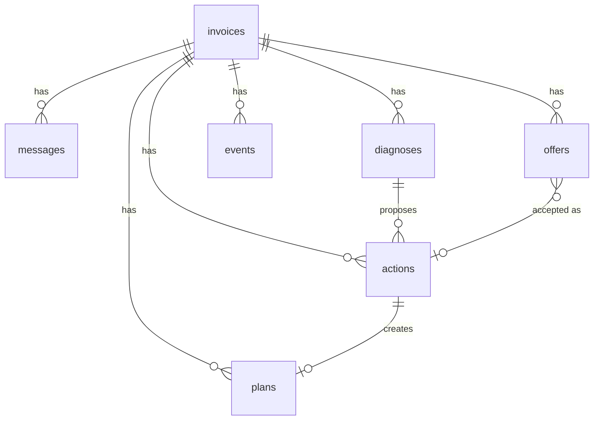

# Database Design

SQLite (better-sqlite3, WAL mode). Schema is created idempotently at startup in `src/lib/db.ts`.

| Table | Purpose | Notes |
|---|---|---|
| `invoices` | Mirror of PayPal invoices | `id` = PayPal invoice id. Amounts in cents. `payer_token` (144-bit random) for the private payment page. `disputed` flag. `raw_json` = full PayPal representation |
| `messages` | Client emails (pasted/forwarded or seeded), owner notes, payer-page chat | `author ∈ client, owner, agent, system`; `channel ∈ email, note, resolution_page` |
| `diagnoses` | AI or rules diagnosis per invoice | `input_hash` lets Unstuck skip re-diagnosis when nothing changed |
| `actions` | Every proposed/approved/executed action | `decision ∈ auto, approve, block`; `status ∈ proposed, approved, rejected, executing, executed, failed, blocked`; `checks_json` = itemised policy checks; `result_json` = PayPal receipts (operation, HTTP status, debug id); `paid_minor_before` powers the "cash unstuck" metric |
| `plans` | Payment plans applied in PayPal | Installments in cents; `paid_minor_at_start` so progress = paid since start |
| `offers` | Plans offered to a payer (computed by policy) | `open → accepted / pending_owner / superseded` |
| `events` | Append-only audit log | Every sync, diagnosis, decision, PayPal call, webhook, payment |
| `settings` | Policy JSON, AI usage counter, demo markers | |
| `webhook_events` | PayPal event-id dedupe | Failed processing removes the row so PayPal's retry is processed |
| `sim_invoices` | SimulatedGateway storage | Unused in sandbox mode |

**Retention.** Hosted on Render free, the file lives in `/tmp` and is lost on restart. PayPal still holds every invoice, sync rebuilds the mirror, and demo conversations are re-attached by invoice number. For production: Postgres or a persistent disk.
