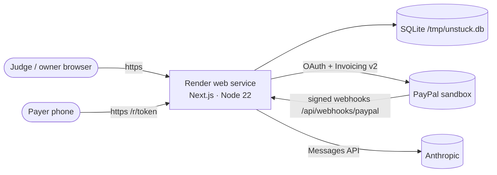

# Deployment Architecture



## Render (sponsor)

`render.yaml` is a Blueprint for a free Node web service.

1. Render dashboard → **New → Blueprint** → select the repo.
2. Fill the `sync: false` secrets: `PAYPAL_CLIENT_ID`, `PAYPAL_CLIENT_SECRET`, `ANTHROPIC_API_KEY`, `DEMO_PAYER_EMAIL`, `APP_BASE_URL` (the `https://unstuck-xxxx.onrender.com` URL), optionally `OWNER_BASIC_AUTH`.
3. After the first deploy, run `npm run check:sandbox -- --register-webhook` locally with the same credentials and `APP_BASE_URL`, then set `PAYPAL_WEBHOOK_ID` in Render and redeploy.
4. Seed once from your machine: `npm run seed:sandbox`. Invoices live in PayPal, so the hosted app picks them up on first load (auto-sync) and re-attaches the demo conversations.

Free-tier notes: the instance sleeps after 15 min idle (first request ~30 s), and local disk is ephemeral. Unstuck tolerates both because PayPal is the source of truth. A paid instance with a persistent disk keeps the audit log across restarts.

**Without credentials** the same deployment runs as a labelled simulation, which is useful as a public explore-only demo.

## Docker

```bash
docker build -t unstuck .
docker run -p 3000:3000 --env-file .env.local -v unstuck-data:/data unstuck
```

## Local

```bash
npm install
cp .env.example .env.local   # optional: add sandbox + Anthropic keys
npm run dev
```

Health check: `GET /api/health`.
