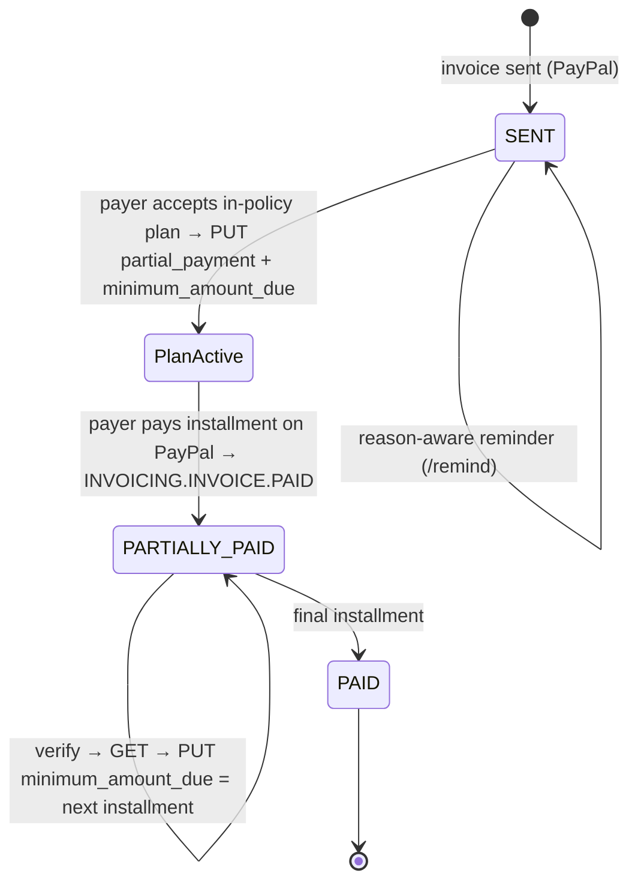

# PayPal Integration

Unstuck is built on **PayPal Invoicing v2**. Every remedy the agent chooses ends in a PayPal API call.

## Operations used

| Purpose | Endpoint | Where |
|---|---|---|
| Auth | `POST /v1/oauth2/token` (client credentials, cached until 60 s before expiry; refreshed once on 401) | `paypal/client.ts` |
| Import | `GET /v2/invoicing/invoices` (paged) + `GET /v2/invoicing/invoices/{id}` | `LivePayPalGateway.listInvoices/getInvoice` |
| Reason-aware reminder | `POST /v2/invoicing/invoices/{id}/remind` `{subject, note, send_to_invoicer:false, additional_recipients?}` | `sendReminder` |
| Payment plan | `PUT /v2/invoicing/invoices/{id}` with `configuration.partial_payment = {allow_partial_payment:true, minimum_amount_due}` and the plan written into `detail.note` | `updateInvoice` + `buildInvoiceUpdateBody` |
| Next installment | `PUT …` updating `minimum_amount_due` after each payment | `services/payments.ts` |
| PO / AP fix | `PUT …?send_to_recipient=true` with `detail.reference` and `additional_recipients` (AP CC) | |
| Early-payment discount | `POST …/conditional-rules` `{rules:[{conditional_rule_type:"EARLY_PAYMENT_DISCOUNT", conditional_rule_value_type:"PERCENT", conditional_rule_value, rule_expiry_terms:{rule_expiry_condition:"SPECIFIC_DATE", condition_rule_end_date}}]}` | `addConditionalRules` |
| Off-PayPal payment | `POST …/payments` `{method, payment_date, amount, note}` | `recordPayment` |
| Pause reminders (disputes) | `POST …/cancel-reminders` | `cancelAutoReminders` |
| Demo seeding | `POST /v2/invoicing/invoices` then `POST …/send` | `createAndSendInvoice` |
| Webhook verification | `POST /v1/notifications/verify-webhook-signature` | `verifyWebhook` |
| Webhook registration | `POST /v1/notifications/webhooks` | `scripts/check-sandbox.ts` |

Request/response shapes were taken from the published source of PayPal's own `@paypal/agent-toolkit@1.11.0` (which implements these endpoints), because `@paypal/paypal-server-sdk@2.5.0` does not include Invoicing.

## Correctness and safety

- **Full-replacement PUT.** PayPal's invoice update replaces the whole object. Unstuck always `GET`s the current invoice, removes read-only fields (`id`, `status`, `links`, `payments`, `refunds`, `due_amount`, `gratuity`, `detail.metadata`, computed `amount` totals), applies one mutation, and `PUT`s it back. Unknown fields are preserved. This is covered by a unit test and by the strict mock in the contract test.
- **Idempotency.** Every write carries `PayPal-Request-Id: unstuck-<action id>`. Writes are retried (429/5xx/network, with exponential backoff) only when they carry an idempotency key.
- **State before action.** Each execution re-fetches the invoice first. A plan whose total no longer equals the amount due is refused ("re-diagnose").
- **Webhooks are signals, not data.** On `INVOICING.INVOICE.PAID` (which fires for full, partial and pending payments) Unstuck verifies the signature, dedupes by event id, then re-reads the invoice from PayPal. Failed processing returns 500 and forgets the event id so PayPal's retry is processed.
- **Sync fallback.** If a webhook is missed, `Sync` detects increased `paid_amount` and runs the same plan-progression path.
- **Sandbox only.** `getGateway()` refuses any `PAYPAL_ENV` other than `sandbox` in this build.
- **Traceability.** `paypal-debug-id` from every call is stored in the action result and the Activity log.

## Lifecycle of a plan

## Sandbox setup

1. Create a REST app at <https://developer.paypal.com/dashboard/applications/sandbox>. Copy the **Client ID** and **Secret** into `.env.local`.
2. Note the email of your **sandbox personal (buyer)** account (Testing Tools → Sandbox Accounts) and set `DEMO_PAYER_EMAIL`.
3. `npm run check:sandbox` confirms OAuth and the Invoicing API.
4. `npm run seed:sandbox` creates the demo studio's 12 invoices in your sandbox business account (5 paid history, 7 open). Bluebird Café's invoice goes to your buyer account.
5. For webhooks, expose the app over https (Render URL or a tunnel), set `APP_BASE_URL`, run `npm run check:sandbox -- --register-webhook`, and put the printed id into `PAYPAL_WEBHOOK_ID`. Without a webhook, use **Sync with PayPal** after paying.
6. In the payer page, **Pay with PayPal** opens PayPal's sandbox invoice page. Log in as the buyer and pay the first installment.

## Sandbox verification status

| Item | Status |
|---|---|
| Request shapes for all operations | Verified against PayPal Agent Toolkit 1.11.0 source |
| Full stack against a strict mock PayPal (23 checks, 84 HTTP calls) | **Verified** (`npm run test:contract`) |
| Live sandbox run | **Pending.** This build environment's network policy blocks `api-m.sandbox.paypal.com`; run `npm run check:sandbox && npm run seed:sandbox` locally or on Render |
| Back-dated `invoice_date` / past `due_date` on create | Unknown; the seeder retries with today's date if PayPal rejects it (days-overdue will then be smaller) |
